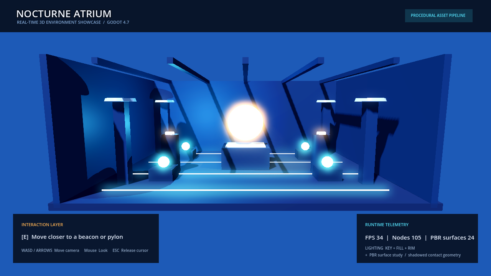
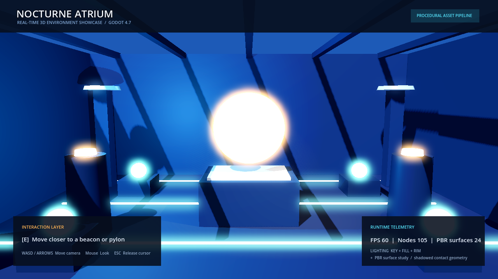
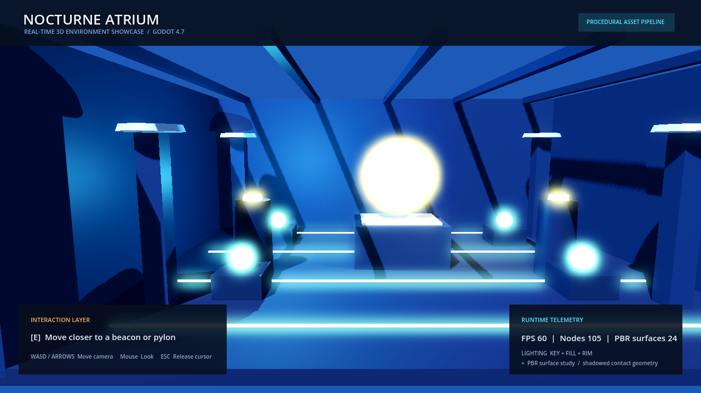

# Godot 3D Environment Showcase

**Nocturne Atrium** is a compact, interactive real-time 3D environment built
with Godot 4.7.2. It is a portfolio proof of scene construction, lighting,
PBR material authoring, camera movement, collision setup, interaction design,
and runtime quality awareness.

## Project Overview

The scene is an asset-light atrium assembled from Godot primitive meshes and
procedural material definitions. Its scope is intentionally small so the
visual result, technical choices, and runtime behavior can be inspected in a
single sitting.

## Features

- WorldEnvironment with ambient light, filmic tonemapping, and glow.
- Directional, omni, and spot lights with shadows enabled.
- PBR materials with explicit albedo, roughness, metallic, specular, emission,
  and a procedural normal map on the cyan trim surfaces.
- Procedural floor, walls, columns, pylons, plinth, rings, and beacon meshes.
- StaticBody3D + BoxShape3D collision for the structural environment.
- Free camera rig with keyboard movement and mouse look.
- Two classes of interactable objects: a floating beacon and two pylons.
- HUD with interaction prompt, FPS, node count, and material count.

## Technical Highlights

| Area | Evidence |
| --- | --- |
| Scene organization | `src/showcase_main.gd` separates environment, lighting, architecture, player, and UI construction. |
| Material pipeline | `_material()` creates `StandardMaterial3D` with controlled roughness, metallic, emission, and procedural normal values. |
| Lighting | Named key/fill/rim roles use three different Godot light types with shadows. |
| Interaction | `_nearest_index()` and `_toggle_nearest()` provide verifiable runtime state changes. |
| Delivery awareness | Runtime telemetry and a documented optimization rationale expose quality decisions. |

## Project Structure

```text
project.godot
scenes/showcase_main.tscn  # Minimal entry scene
src/showcase_main.gd       # Runtime environment and interaction system
assets/README.md            # Asset provenance statement
docs/scene_breakdown.md     # Build, lighting, material, and QA notes
screenshots/                # Captured evidence from the running project
```

## Controls

- `WASD` or arrow keys: move the camera rig
- `Q` / `Z`: move vertically
- Click the viewport: capture the mouse for look control
- Mouse: look around
- `E`: activate/deactivate the nearest beacon or pylon
- `Esc`: release the mouse cursor

## Screenshots







The images above are captured from this project running locally with Godot;
they are not mockups or stock images.

## Quality / QA Considerations

- The entry scene is a valid Godot 4 scene and contains no external resource
  dependencies.
- Structural meshes have matching primitive collision shapes.
- Light roles and shadows are explicit and inspectable.
- The HUD provides a lightweight FPS and node-count signal during review.
- The project was run with Godot's command-line project validation and capture
  flow; the final report records the observed QA result.

## Performance Considerations

The scene uses primitive meshes, simple box collisions, a small node budget,
and no runtime asset streaming. This makes it suitable for technical review on
the GL Compatibility renderer. The main trade-off is that the visual study
prioritizes readable lighting and material contrast over large-world scale.

## Problems & Solutions

See [`docs/scene_breakdown.md`](docs/scene_breakdown.md) for the detailed
scene breakdown, lighting roles, material decisions, and problem/solution log.

## How to Run

1. Install Godot 4.7.2 or open the project with a compatible Godot 4.x build.
2. Import/open this folder in Godot.
3. Run the project; the main scene is `scenes/showcase_main.tscn`.

Headless validation used during portfolio QA:

```text
Godot_v4.7.2-stable_win64_console.exe --path . --headless --editor --quit
Godot_v4.7.2-stable_win64_console.exe --path . --headless -- --capture=overview
```

## License

MIT. The project contains no third-party art assets.
